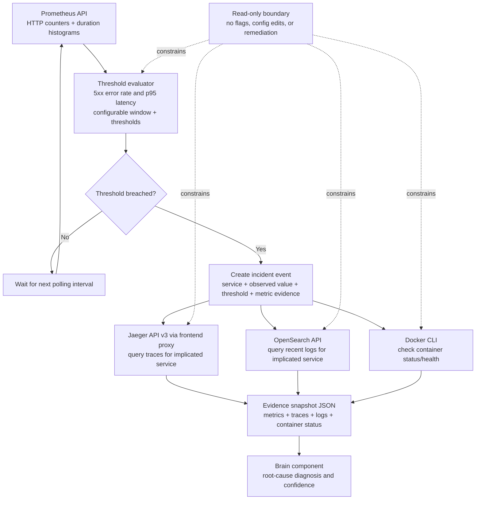

# Team 21 — Eyes architecture (one-page sketch)

**Trigger rules (defaults):** HTTP 5xx error ratio ≥ 5% (only after ≥20 requests) or HTTP request p95 latency ≥ 1,000 ms, evaluated over the preceding 300 seconds. All thresholds are configurable. An unhealthy/stopped container is also surfaced as a secondary observation.

**Evidence policy:** The watcher starts with metrics and container status. It queries traces/logs only after a threshold incident is detected. It reports the observed value, threshold, time window, source metric/PromQL, trace summaries, log samples, and related container status. It does not infer root cause; Brain owns diagnosis.

**Safety boundary:** no demo configuration or feature-flag reads, no manual fault injection, no service changes, no calls to remediation/action APIs. Live incident testing must use the hackathon-approved practice-incident mechanism.
